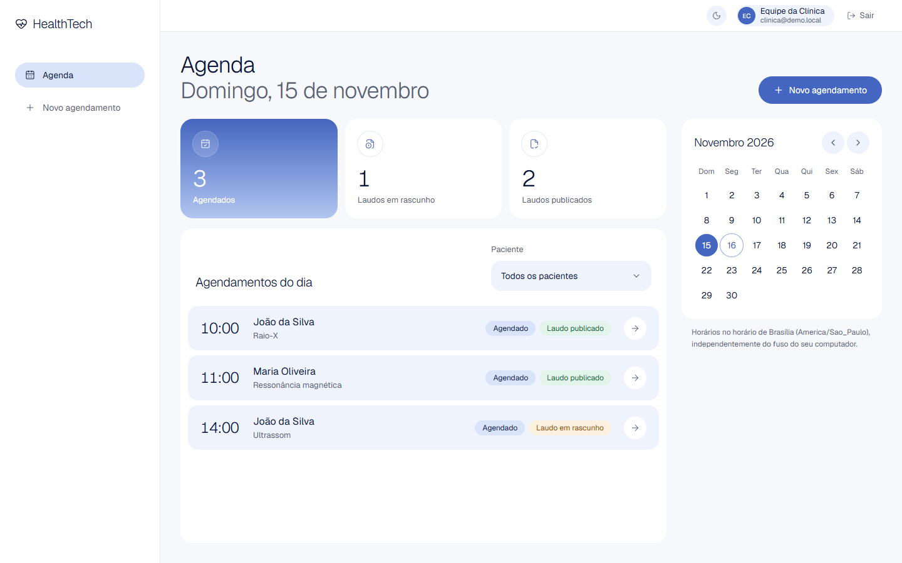
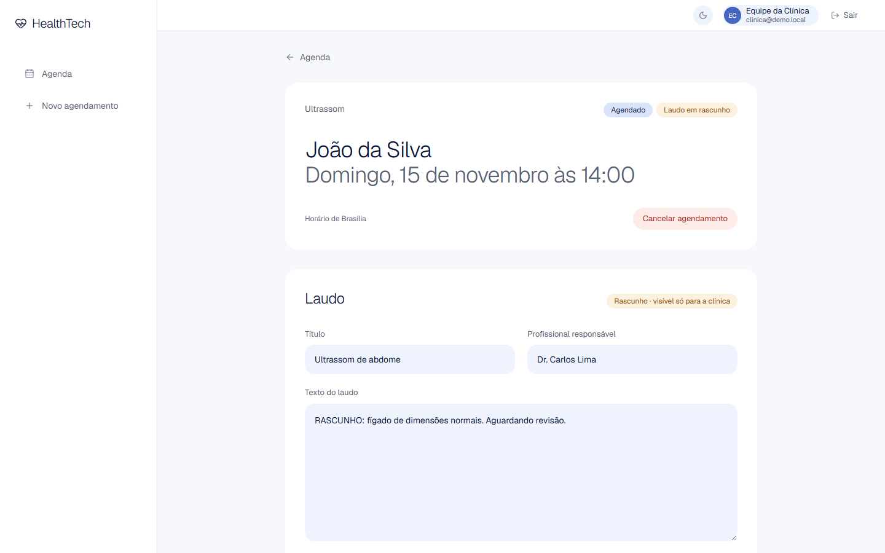
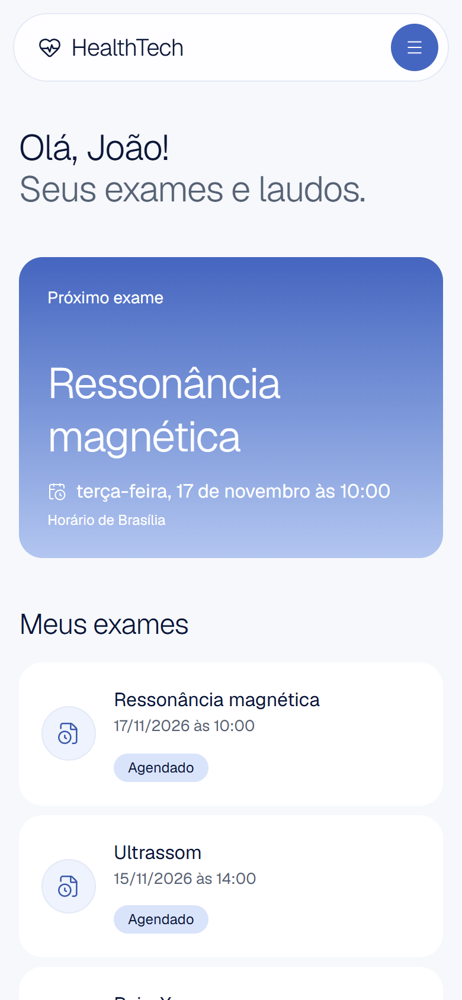
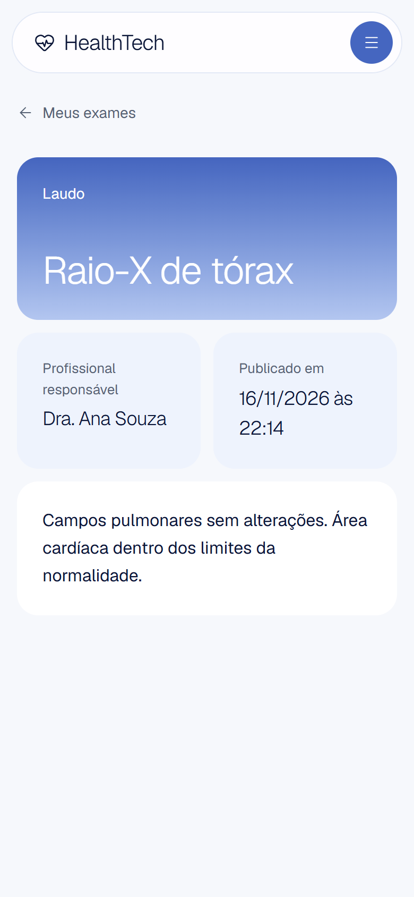
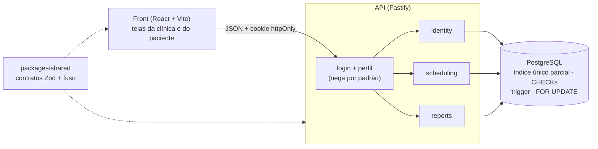

# HealthTech — Agendamento de exames e acesso a laudos

[](https://github.com/renatomf/healthtech/actions/workflows/ci.yml)

Aplicação web para uma clínica agendar exames, cadastrar laudos (rascunho → publicado) e disponibilizá-los ao paciente.

## Como rodar em 1 minuto

Você só precisa do **Docker Desktop**. Não precisa instalar Node, banco de dados nem configurar nada.

**1. Instale e abra o Docker Desktop** → [docker.com/products/docker-desktop](https://www.docker.com/products/docker-desktop/). Espere ele mostrar _Engine running_.

**2. Baixe o projeto**, de um destes jeitos:

- Com Git: `git clone https://github.com/renatomf/healthtech.git` e depois `cd healthtech`
- Sem Git: no GitHub, clique em **Code → Download ZIP**, extraia e abra um terminal dentro da pasta extraída
  (Windows: abra a pasta no Explorador, clique na barra de endereço, digite `cmd` e aperte Enter)

**3. No terminal, dentro da pasta do projeto, rode:**

```bash
docker compose up -d
```

Na primeira vez leva de 2 a 5 minutos (baixa e monta tudo). Nas próximas, segundos.

**4. Abra http://localhost:5173 e entre** com uma das contas (a senha de todas é `Demo@1234`):

| E-mail               | Quem é                                                     |
| -------------------- | ---------------------------------------------------------- |
| `clinica@demo.local` | Equipe da clínica: agenda exames, escreve e publica laudos |
| `joao@demo.local`    | Paciente: vê os próprios exames e lê os laudos publicados  |
| `maria@demo.local`   | Outra paciente (para ver que um não enxerga o outro)       |

Os dados de demonstração já vêm carregados. Para **parar**: `docker compose down`. Não abriu? Veja [Se algo der errado](#se-algo-der-errado).

## Telas

**Equipe da clínica** — agenda do dia e editor de laudo:





**Paciente** — no celular, exames e leitura do laudo:

<p>
  
  &nbsp;
  
</p>

---

**Em uma frase:** as regras críticas (horário único, laudo imutável, paciente só vê o que é dele) são garantidas pelo banco e pela consulta, não só pela tela, e cada uma tem um teste que a prova — inclusive sob concorrência e com o servidor em outro fuso.

**Stack:** React + Vite + TypeScript · Fastify + TypeScript · PostgreSQL + Drizzle · Vitest + Testcontainers + Playwright · Docker Compose · pnpm workspaces.

## Sumário

1. [Como rodar em 1 minuto](#como-rodar-em-1-minuto)
2. [Telas](#telas)
3. [Entrega](#entrega)
4. [Como executar](#como-executar)
5. [Banco e dados fictícios](#banco-e-dados-fictícios)
6. [Contas de demonstração](#contas-de-demonstração)
7. [Testes](#testes)
8. [Variáveis de ambiente](#variáveis-de-ambiente)
9. [Matriz de requisitos](#matriz-de-requisitos)
10. [Roteiro de avaliação](#roteiro-de-avaliação)
11. [Arquitetura](#arquitetura)
12. [Decisões técnicas](#decisões-técnicas)
13. [Fuso horário adotado](#fuso-horário-adotado)
14. [Limitações e pendências](#limitações-e-pendências)
15. [Tempo dedicado](#tempo-dedicado)
16. [Créditos](#créditos)

## Entrega

O que o enunciado pede e onde está:

| Item pedido                                                      | Onde está                                                                                                                                                                |
| ---------------------------------------------------------------- | ------------------------------------------------------------------------------------------------------------------------------------------------------------------------ |
| Código do frontend e do backend                                  | [`apps/web`](apps/web) (React + Vite), [`apps/api`](apps/api) (Fastify), [`packages/shared`](packages/shared) (contratos Zod e fuso usados pelos dois)                   |
| Instruções para instalar e executar                              | [Como rodar em 1 minuto](#como-rodar-em-1-minuto) (só Docker) e [Como executar](#como-executar) (comandos do dia a dia, problemas comuns, modo de desenvolvimento)       |
| Preparar o banco e carregar dados fictícios                      | [Banco e dados fictícios](#banco-e-dados-fictícios): migrations aplicadas ao subir a API; seed com datas relativas a hoje                                                |
| Credenciais das contas de demonstração                           | [Contas de demonstração](#contas-de-demonstração) (também visíveis na tela de login)                                                                                     |
| Instruções para executar os testes                               | [Testes](#testes): unitários, integração com Postgres real, E2E com Playwright + axe                                                                                     |
| Arquivo de exemplo das variáveis de ambiente, sem segredos reais | [`.env.example`](.env.example) (só valores de desenvolvimento; o `JWT_SECRET` de exemplo pede para ser trocado) e [Variáveis de ambiente](#variáveis-de-ambiente)        |
| Decisões técnicas, limitações e pendências                       | [Arquitetura](#arquitetura), [Decisões técnicas](#decisões-técnicas), [Fuso horário adotado](#fuso-horário-adotado), [Limitações e pendências](#limitações-e-pendências) |
| Tempo aproximado dedicado                                        | [Tempo dedicado](#tempo-dedicado)                                                                                                                                        |

Além do pedido: [roteiro de teste manual](docs/ROTEIRO_TESTE.md) passo a passo, [matriz requisito → garantia → teste](#matriz-de-requisitos) e CI no GitHub Actions.

```
apps/
  api/        Fastify: módulos identity, scheduling e reports (domain → application → infra → http)
  web/        React: telas da clínica e do paciente
packages/
  shared/     contratos Zod (request/response) e utilitários de fuso
e2e/          Playwright + axe
scripts/      demo-race.ts (10 reservas simultâneas)
docs/         requisitos, arquitetura, segurança, testes, ADRs, roteiro de teste
```

## Como executar

O passo a passo para leigos está em [Como rodar em 1 minuto](#como-rodar-em-1-minuto). Aqui ficam os detalhes.

**Como saber se deu certo:** `docker compose ps` mostra `db` e `api` como `healthy`, e http://localhost:3333/health/live responde `{"status":"ok"}`.

| Quero…                                    | Comando                                       |
| ----------------------------------------- | --------------------------------------------- |
| Parar                                     | `docker compose down`                         |
| Voltar os dados de demonstração ao início | `docker compose exec api node src/db/seed.ts` |
| Apagar tudo, inclusive o banco            | `docker compose down -v`                      |
| Ver os logs da API                        | `docker compose logs -f api`                  |

| Serviço         | Endereço                                                                        |
| --------------- | ------------------------------------------------------------------------------- |
| Aplicação (web) | http://localhost:5173                                                           |
| API             | http://localhost:3333                                                           |
| PostgreSQL      | `localhost:15432` (fora da 5432, para não colidir com um Postgres já instalado) |

### Se algo der errado

| Sintoma                                                                   | O que fazer                                                                                                       |
| ------------------------------------------------------------------------- | ----------------------------------------------------------------------------------------------------------------- |
| `Cannot connect to the Docker daemon` / `docker: command not found`       | Abra o Docker Desktop e espere ele ficar "running"                                                                |
| `port is already allocated`                                               | Outra coisa usa a porta 5173, 3333 ou 15432. Feche-a, ou troque `POSTGRES_HOST_PORT` no `.env` (banco)            |
| `docker compose` não é reconhecido                                        | Docker Desktop desatualizado: atualize (o Compose v2 vem junto)                                                   |
| `corepack enable` dá "EPERM: operation not permitted" (Windows)           | Rode `npm install -g pnpm` (não precisa de administrador) ou abra o terminal como administrador                   |
| "O sistema não pode encontrar o caminho especificado" no `pnpm` (Windows) | Caminho da pasta longo demais: clone numa pasta curta, como `C:\projetos\healthtech`                              |
| API não sobe e o log diz "Variáveis de ambiente inválidas"                | Você criou um `.env` com algum valor errado: apague-o (o projeto roda sem ele) ou copie de novo do `.env.example` |
| "E-mail ou senha incorretos" com as contas acima                          | Os dados foram apagados: rode `docker compose exec api node src/db/seed.ts`                                       |
| "Muitas tentativas" no login                                              | Limite de 5 tentativas por minuto: espere um minuto                                                               |

### Desenvolvimento local (opcional)

Para mexer no código com recarga automática. **Você precisa de:** Docker (só para o banco), Node 24 (ver `.nvmrc`) e pnpm (`corepack enable` habilita a versão certa).

```bash
cp .env.example .env
corepack enable             # ou, se der "EPERM" no Windows: npm install -g pnpm
pnpm install
docker compose up -d db     # só o banco
pnpm db:migrate             # cria as tabelas
pnpm db:seed                # carrega os dados de demonstração
pnpm dev                    # API em :3333 e web em :5173, com recarga automática
```

Se o stack completo do Docker estiver rodando, pare antes os serviços `api` e `web` (`docker compose stop api web`), porque usam as mesmas portas.

## Banco e dados fictícios

| Comando            | O que faz                                                                             |
| ------------------ | ------------------------------------------------------------------------------------- |
| `pnpm db:migrate`  | Aplica as migrations versionadas (`apps/api/src/db/migrations`)                       |
| `pnpm db:seed`     | Recria os dados fictícios                                                             |
| `pnpm db:reset`    | Apaga o banco, aplica as migrations e roda o seed                                     |
| `pnpm db:generate` | Gera migration a partir de `schema.ts` (só desenvolvimento; nunca `drizzle-kit push`) |

Com Docker, os dados de demonstração são carregados sozinhos na primeira subida. O seed manual apaga os dados e recria tudo com datas **relativas a hoje** (fuso da clínica), então funciona em qualquer dia:

```bash
pnpm db:seed                                  # local
docker compose exec api node src/db/seed.ts   # com Docker
```

| Agendamento | Paciente | Quando                 | Estado                                    |
| ----------- | -------- | ---------------------- | ----------------------------------------- |
| A           | João     | ontem 10:00            | agendado, laudo publicado                 |
| B           | João     | ontem 14:00            | agendado, laudo em rascunho               |
| C           | Maria    | ontem 11:00            | agendado, laudo publicado                 |
| D           | Maria    | amanhã 09:00           | cancelado (horário livre para reutilizar) |
| E           | João     | amanhã 10:00           | agendado (horário ocupado)                |
| F           | Maria    | depois de amanhã 15:30 | agendado                                  |

## Contas de demonstração

| Conta                | Senha       | Perfil            |
| -------------------- | ----------- | ----------------- |
| `clinica@demo.local` | `Demo@1234` | Equipe da clínica |
| `joao@demo.local`    | `Demo@1234` | Paciente          |
| `maria@demo.local`   | `Demo@1234` | Paciente          |

## Testes

Rodar a aplicação só precisa do Docker. **Rodar os testes precisa também de Node 24 e pnpm:**

```bash
corepack enable          # habilita o pnpm (vem com o Node). Erro "EPERM" no Windows? use: npm install -g pnpm
pnpm install
cp .env.example .env     # Windows (cmd): copy .env.example .env
```

| Comando                 | O que roda                                                                                                                                                                                                                                  | Requisitos                                           |
| ----------------------- | ------------------------------------------------------------------------------------------------------------------------------------------------------------------------------------------------------------------------------------------- | ---------------------------------------------------- |
| `pnpm test:unit`        | Regras de domínio, fuso, mensagens do front                                                                                                                                                                                                 | —                                                    |
| `pnpm test:integration` | API + Postgres real (Testcontainers, migrations reais): os 5 cenários do enunciado, corridas, constraints, varredura de autorização                                                                                                         | Docker                                               |
| `pnpm test`             | Os dois acima                                                                                                                                                                                                                               | Docker                                               |
| `pnpm verify`           | Biome + typecheck + dependency-cruiser + `pnpm test` (66 testes)                                                                                                                                                                            | Docker                                               |
| `pnpm test:e2e`         | Playwright no Chrome, 13 testes: os 3 fluxos principais, navegador em `Asia/Tokyo`, tema claro como padrão, filtro só pelo teclado, date picker (dias passados, Esc e foco) e axe em 6 telas nos temas claro e escuro. Reseta o banco antes | Stack no ar (`docker compose up -d`) e Google Chrome |
| `pnpm demo:race`        | 10 reservas simultâneas do mesmo horário contra a API rodando: 1 aceita, 9 × 409                                                                                                                                                            | Stack no ar com seed                                 |

Os 5 cenários do enunciado estão em `describe('Cenário N — …')`: [agendamento](apps/api/src/modules/scheduling/http/scenarios.int.test.ts) (1 e 5) e [laudos](apps/api/src/modules/reports/http/scenarios.int.test.ts) (2, 3 e 4). O CI roda tudo com `TZ=UTC` e com `TZ=Asia/Tokyo`.

## Variáveis de ambiente

Com Docker, **nenhuma é obrigatória**: o `docker-compose.yml` traz valores padrão de desenvolvimento. Para trocar alguma, copie [`.env.example`](.env.example) para `.env` (sem segredos reais). No modo de desenvolvimento local e para os testes, o `.env` é necessário. A API valida tudo com Zod ao iniciar.

| Variável                                            | Padrão / exemplo                      | Uso                                                           |
| --------------------------------------------------- | ------------------------------------- | ------------------------------------------------------------- |
| `POSTGRES_USER`, `POSTGRES_PASSWORD`, `POSTGRES_DB` | `clinic` / … / `clinic`               | Banco do Compose                                              |
| `POSTGRES_HOST_PORT`                                | `15432`                               | Porta do banco no host                                        |
| `DATABASE_URL`                                      | `postgres://…@localhost:15432/clinic` | Conexão da API (no Compose é sobrescrita para o serviço `db`) |
| `JWT_SECRET`                                        | ≥ 32 caracteres                       | Assinatura do token. **Troque em produção**                   |
| `JWT_EXPIRES_IN`                                    | `8h`                                  | Validade da sessão                                            |
| `WEB_ORIGIN`                                        | `http://localhost:5173`               | Única origem liberada no CORS                                 |
| `CLINIC_TIMEZONE`                                   | `America/Sao_Paulo`                   | Fuso de exibição e de "dia"                                   |
| `CLINIC_OPEN_TIME` / `CLINIC_CLOSE_TIME`            | `08:00` / `18:00`                     | Funcionamento (último horário 17:30)                          |
| `VITE_API_URL`                                      | `http://localhost:3333`               | URL da API usada pelo front (no build)                        |

## Matriz de requisitos

| Requisito                                              | Onde é garantido                 | Teste                |
| ------------------------------------------------------ | -------------------------------- | -------------------- |
| Não agendar no passado                                 | domínio + `Clock`                | Cenário 5            |
| Sem dois agendamentos ativos no mesmo horário          | `uq_active_slot` → 409           | Cenário 1            |
| Reutilizar horário cancelado                           | índice parcial                   | integração           |
| Slots de 30 min                                        | `chk_slot_aligned` + `/slots`    | integração           |
| Um laudo por agendamento                               | `uq_report_appointment`          | integração           |
| Rascunho só para a clínica                             | DTO do paciente + query          | Cenário 3            |
| Publicado disponível ao paciente correto               | query por `patient_id`           | Cenário 4            |
| Paciente não acessa dados de outro                     | escopo na query → 404            | Cenário 2            |
| Publicado não é editável                               | UPDATE condicional + trigger     | integração           |
| Cancelado não recebe laudo / publicado não é cancelado | `FOR UPDATE` + domínio           | integração (corrida) |
| Data de publicação registrada                          | `published_at` + `chk_published` | Cenário 4            |
| Autorização no backend                                 | `requireRole` + escopo           | varredura de rotas   |

## Roteiro de avaliação

Roteiro completo, passo a passo e com o resultado esperado de cada ação: **[`docs/ROTEIRO_TESTE.md`](docs/ROTEIRO_TESTE.md)** (~20 min). Versão curta, com o stack no ar e o seed carregado (~10 min):

1. **Clínica** — entre como `clinica@demo.local`. No calendário, escolha **ontem**: A (João, publicado), B (João, rascunho) e C (Maria, publicado).
2. **Rascunho → publicado** — abra B, edite o texto, _Salvar rascunho_ e _Publicar laudo_ (com confirmação). Os campos travam e aparece a data de publicação.
3. **Paciente** — saia e entre como `joao@demo.local`: o Ultrassom agora mostra **Laudo disponível**; abra e leia. Entre como `maria@demo.local`: ela não vê nada do João.
4. **Publicado não cancela** — como clínica, abra A: _Cancelar agendamento_ está bloqueado (a API também recusa: 409 `APPOINTMENT_HAS_PUBLISHED_REPORT`).
5. **Horários** — _Novo agendamento_ para **amanhã**: 10:00 aparece ocupado (E); 09:00 está livre porque D foi cancelado; horários de hoje que já passaram aparecem riscados.
6. **Concorrência** — `pnpm demo:race`: 10 reservas simultâneas, 1 aceita e 9 × 409.
7. **API direto** — [`docs/api/api.http`](docs/api/api.http) (REST Client): paciente lendo laudo de outro → 404; perfil errado → 403; sem login → 401; campo extra → 400; `traceId` = `x-request-id`.
8. **Fuso** — os horários são sempre de Brasília: mude o fuso do computador e recarregue, ou veja o teste E2E que roda o navegador em `Asia/Tokyo`.
9. **Visual** — alterne claro/escuro no canto da tela; abra no celular (ou DevTools em 390 px).

## Arquitetura

Um **monólito modular** em TypeScript: uma API (Fastify) e um front (React) que compartilham os mesmos contratos, sobre um PostgreSQL que é a última palavra nas regras críticas. A escolha é deliberada para o tamanho do problema: um único deploy e uma transação local cobrem agendamento e laudo, sem a complexidade de serviços separados, e as fronteiras internas ficam claras o bastante para extrair um módulo no futuro.



### Módulos e camadas

A API tem três módulos, um por área do negócio: **identity** (login, sessão, busca de pacientes), **scheduling** (agendamentos e horários) e **reports** (laudos e a visão do paciente). Cada módulo tem as mesmas quatro camadas, e cada uma só conhece a de baixo:

| Camada        | O que faz                                                            | Exemplo                                                     |
| ------------- | -------------------------------------------------------------------- | ----------------------------------------------------------- |
| `http`        | Rotas, validação da entrada e formato da resposta (Zod)              | `POST /clinic/appointments`                                 |
| `application` | Casos de uso: orquestra, abre a transação, traduz regra em erro HTTP | `createAppointment`, `publishReport`                        |
| `domain`      | Regras puras, sem banco nem framework, testadas com unitários        | `checkSlot` (grade, passado, expediente), `checkCanPublish` |
| `infra`       | Consultas ao banco (Drizzle) e tradução dos erros do Postgres        | `insertAppointment` transforma o erro do índice em 409      |

Essas fronteiras são verificadas no CI pelo `dependency-cruiser`: o `domain` não pode importar banco nem Fastify, e um módulo não pode usar o `infra` de outro. O relógio também é injetado (`Clock`), então "agora" é fixo nos testes e o domínio nunca chama `new Date()` sozinho.

### O caminho de uma reserva

O que acontece quando a clínica confirma um horário, e por que duas pessoas no mesmo horário não geram dois agendamentos:

1. **Front:** a tela só mostra horários livres, mas isso é conveniência. A fonte da verdade é a API.
2. **`http`:** o corpo é validado com o schema compartilhado (campos extras são recusados) e o grupo `/clinic` exige login com perfil de clínica.
3. **`domain`:** `checkSlot` recusa horário fora da grade de 30 minutos, no passado ou fora do expediente, sempre no fuso da clínica.
4. **`infra` + banco:** o `INSERT` vai direto, sem "verificar antes". Se outra reserva ganhou a corrida, o **índice único parcial** `uq_active_slot` recusa a segunda e a API devolve 409 `SLOT_UNAVAILABLE`. Agendamentos cancelados ficam fora do índice, por isso o horário deles volta a ficar livre.
5. **Front:** recebe o 409, mostra "Esse horário acabou de ser ocupado" e recarrega a grade.

Cancelar, salvar e publicar laudo seguem a mesma ideia com outro mecanismo: começam travando a linha do agendamento (`SELECT … FOR UPDATE`), então cancelar e publicar o mesmo exame ao mesmo tempo acontecem em fila, e o resultado é sempre um estado válido.

### Onde cada garantia mora

As regras importantes valem em mais de uma camada, para que um erro numa delas não vire um dado errado:

- **Banco:** horário único entre os ativos, grade de 30 minutos, um laudo por agendamento, data de publicação obrigatória para laudo publicado, e um trigger que impede alterar laudo publicado mesmo por SQL direto.
- **Domínio:** as mesmas regras com mensagens claras (passado, expediente, cancelado sem laudo, publicado sem cancelamento).
- **Consulta:** o paciente só enxerga o que é dele porque o filtro pelo paciente do token está **dentro do SQL**, não num `if` depois. Laudo de outro paciente ou rascunho retorna 404, sem revelar que existe.
- **Resposta:** cada perfil tem seu próprio formato de resposta; o do paciente nem tem campo para o texto do rascunho.

### Front

Organizado por perfil (`features/auth`, `features/clinic`, `features/patient`). Os dados vêm da API com TanStack Query, os formulários usam React Hook Form validado pelo **mesmo schema Zod** da API, e as datas são sempre exibidas no horário de Brasília pelos utilitários de `packages/shared`, independentemente do fuso do computador. Os componentes de interface são próprios e pequenos (botão, card, campo, selo, diálogo, select e calendário acessíveis), com tema claro e escuro por tokens de cor.

A ligação entre os dois lados é o pacote `packages/shared`: se um contrato muda, front e API deixam de compilar juntos, e a quebra aparece no `pnpm verify` antes de chegar ao navegador.

## Decisões técnicas

As escolhas que moldam a arquitetura acima, com o motivo de cada uma. Cada linha tem um ADR em `docs/adr/` com as alternativas consideradas.

| Decisão                                                                                                      | Por quê                                                                                                                   | Detalhe                                             |
| ------------------------------------------------------------------------------------------------------------ | ------------------------------------------------------------------------------------------------------------------------- | --------------------------------------------------- |
| Monólito modular (`identity`, `scheduling`, `reports`), camadas verificadas no CI                            | Uma transação local cobre agendamento e laudo; fronteiras sem a cerimônia de microsserviços                               | [ADR-001](docs/adr/001-monolito-modular.md)         |
| PostgreSQL + Drizzle, migrations versionadas (nunca `push`)                                                  | As regras críticas dependem de recursos do banco: índice parcial, CHECK, `FOR UPDATE`, `timestamptz`                      | [ADR-002](docs/adr/002-postgresql-drizzle.md)       |
| **Índice único parcial** `uq_active_slot` decide a disputa pelo horário                                      | Checar e depois inserir falha sob concorrência; o índice deixa só um vencer e libera o horário cancelado                  | [ADR-003](docs/adr/003-indice-unico-parcial.md)     |
| **Lock de linha** no agendamento para cancelar, salvar e publicar laudo; status do laudo lido depois do lock | Cancelar × publicar ao mesmo tempo não pode terminar cancelado com laudo publicado (o teste de corrida pegou um bug aqui) | [ADR-004](docs/adr/004-lock-de-linha.md)            |
| UTC no banco, **horário de Brasília** na exibição e no cálculo de "dia"                                      | Mesma data para clínica e paciente, independente do fuso do navegador ou do servidor                                      | [ADR-005](docs/adr/005-fuso-horario.md)             |
| JWT em cookie `httpOnly`, perfil conferido no banco a cada requisição                                        | Simples, como pede o enunciado, sem expor o token a scripts                                                               | [ADR-006](docs/adr/006-jwt-cookie-httponly.md)      |
| Autorização **na própria consulta** (`patient_id` do token); recurso de outro paciente → 404                 | Não depende de lembrar um `if` em cada rota e não revela que o recurso existe                                             | [ADR-007](docs/adr/007-autorizacao-escopo-query.md) |
| Testes de integração com **Postgres real** (Testcontainers)                                                  | Concorrência e constraints só se provam no banco de verdade                                                               | [ADR-008](docs/adr/008-testes-postgres-real.md)     |
| Fastify + contratos Zod em `packages/shared`                                                                 | Validação, serialização e formulários com o mesmo schema; o DTO do paciente não tem campo de rascunho                     | [ADR-009](docs/adr/009-fastify-contratos-zod.md)    |
| Front em React + Vite + Tailwind, select e date picker próprios e acessíveis                                 | Visual consistente nos dois temas; axe sem violações sérias                                                               | [ARQUITETURA.md](docs/ARQUITETURA.md)               |

Mais: [arquitetura](docs/ARQUITETURA.md) · [segurança e LGPD](docs/SEGURANCA.md) · [estratégia de testes](docs/TESTES.md) · [interpretações do enunciado](docs/INTERPRETACOES.md).

## Fuso horário adotado

Datas armazenadas em UTC (`timestamptz`). Exibição e cálculo de "dia" sempre em **America/Sao_Paulo (horário de Brasília)**, configurável por `CLINIC_TIMEZONE`, independentemente do fuso do navegador ou do servidor.

## Limitações e pendências

**Limitações conscientes (do escopo)**

- Uma sala e horários fixos de 30 min (enunciado). Várias salas: `room_id` no índice único; duração variável: _exclusion constraint_ com `tstzrange` (ADR-003).
- Mesmo horário de funcionamento todos os dias, inclusive fim de semana; sem feriados.
- `chk_slot_aligned` alinha em UTC — correto para Brasília (offset em horas inteiras), não para fusos de meia hora.
- Pacientes e tipos de exame vêm do seed (não há telas de cadastro); não é possível excluir rascunho (INTERPRETACOES.md #5 e #8).
- Listagem da clínica sem paginação: até 100 agendamentos por consulta (com filtro por dia isso basta).
- Sessão JWT não é revogável antes de expirar (8 h); o perfil é conferido no banco a cada requisição.
- Rate limit do login em memória (vale para uma instância da API).

**Pendências (cortadas pelo prazo, na ordem do plano)**

- Swagger/OpenAPI em `/docs` e `/health/ready` (com checagem do banco).
- Checagem explícita de `Origin` contra CSRF: hoje a proteção é `SameSite=Lax` + mutações só em JSON (formulário de outro site não envia `application/json` sem passar pelo CORS).
- CSP no nginx do front (o helmet cobre só a API).
- Testes de componente do front (as telas são cobertas pelo E2E; unitário só das mensagens).
- Teste de mutação (Stryker) no domínio.
- 3 alertas moderados do `pnpm audit`, todos em ferramentas de desenvolvimento (ver `docs/SEGURANCA.md`).

Pendências para produção (revogação de sessão, MFA, auditoria de leitura, backups, retenção/LGPD): `docs/SEGURANCA.md`.

## Tempo dedicado

| Etapa                                                                     | Quando                                     | Tempo                    |
| ------------------------------------------------------------------------- | ------------------------------------------ | ------------------------ |
| Planejamento: requisitos, arquitetura, segurança, testes e ADRs (`docs/`) | antes do primeiro commit                   | etapa anterior ao código |
| Implementação, testes, front e ajustes                                    | 16/11, 17:21 → 23:35 (horário de Brasília) | ~6h15                    |

Detalhe em [`docs/TEMPO.md`](docs/TEMPO.md).

## Créditos

Foto da tela de login: banco de imagens [Pexels](https://www.pexels.com) ([licença Pexels](https://www.pexels.com/license/): uso livre, sem atribuição obrigatória), fornecida pelo autor e recortada (fundo removido) para compor o painel. Ícones: [Lucide](https://lucide.dev). Fonte: [Geist](https://vercel.com/font).
