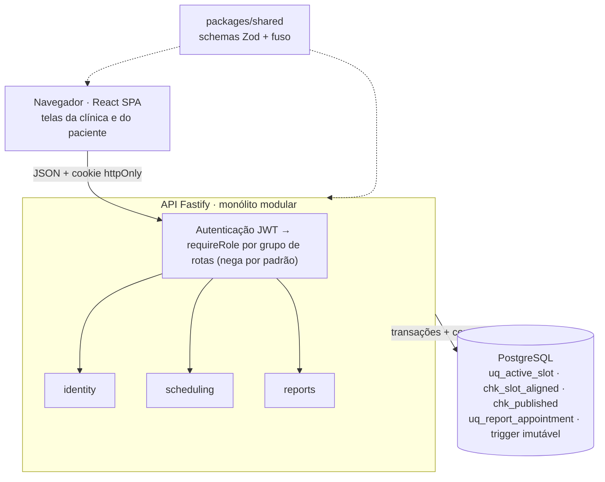
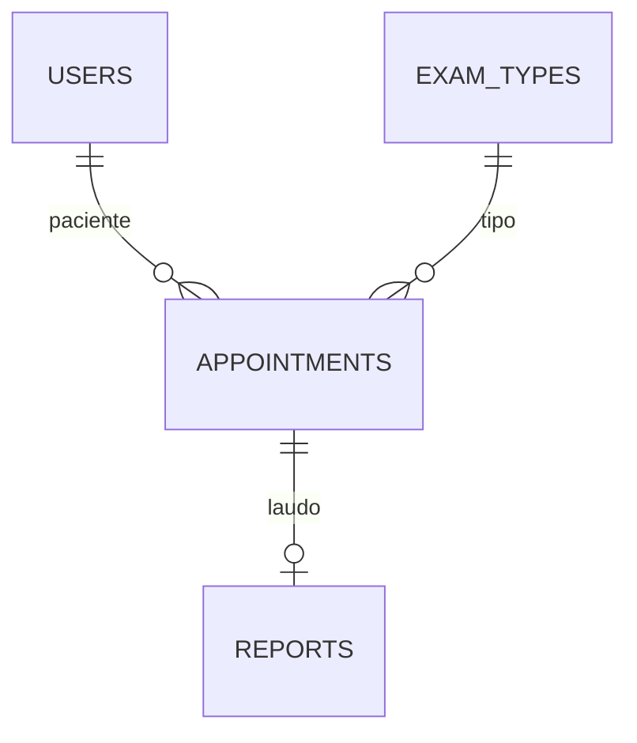

# Arquitetura

Monólito modular em TypeScript (React + Fastify + PostgreSQL). Invariantes garantidas no banco, autorização embutida nas queries, cada regra do enunciado provada por teste.

## Princípios

1. **Correção antes de funcionalidade.** Cada regra tem um lugar onde é garantida e um teste que a prova.
2. **Defesa em profundidade.** Zod na borda → regra pura no domínio → constraint no banco.
3. **Seguro por construção.** Dado que o usuário não pode ver nunca é carregado.
4. **Escopo disciplinado.** Nada além do pedido; o que ficou de fora está em "Pendências" no README.
5. **Experiência do avaliador.** Um comando sobe tudo; seed cobre todas as regras; roteiro de verificação no README.

## Visão geral



## Estrutura do repositório

```
apps/
  api/src/
    modules/
      identity/        # login, logout, me, requireRole
      scheduling/      # agendamentos e slots
        domain/        # regras puras: isValidSlot, isInPast, assertCanCancel
        application/   # casos de uso com transação explícita
        infra/         # repositório Drizzle + mapeamento de erros do Postgres
        http/          # rotas Fastify + schemas Zod
      reports/         # laudos (mesma divisão)
    db/                # schema.ts, migrations/, seed.ts
    shared/            # env, erros (Problem Details), logger, clock
  web/src/
    features/{auth,clinic,patient}/
    components/ui/     # só os componentes shadcn usados
    lib/               # api client, formatação de datas
packages/
  shared/              # contratos Zod + utilitários de fuso
e2e/                   # Playwright
scripts/               # demo-race.ts
docs/                  # este diretório
```

**Regra de dependência:** `http → application → domain`; `infra` implementa o acesso usado por `application`. Verificada por `dependency-cruiser` no CI.

## Modelo de dados

| Tabela         | Colunas principais                                                                                                                                                      | Observações                                |
| -------------- | ----------------------------------------------------------------------------------------------------------------------------------------------------------------------- | ------------------------------------------ |
| `users`        | `id uuid`, `name`, `email unique`, `password_hash`, `role` (`CLINIC` \| `PATIENT`), `created_at`                                                                        | Paciente = usuário com `role = PATIENT`    |
| `exam_types`   | `id`, `code unique`, `name`                                                                                                                                             | Seed: `RAIO_X`, `ULTRASSOM`, `RESSONANCIA` |
| `appointments` | `id uuid`, `patient_id`, `exam_type_id`, `scheduled_at timestamptz`, `status` (`SCHEDULED` \| `CANCELED`), `created_by`, `created_at`, `canceled_by`, `canceled_at`     | Auditoria mínima                           |
| `reports`      | `id uuid`, `appointment_id unique`, `title`, `body`, `professional_name`, `status` (`DRAFT` \| `PUBLISHED`), `published_at`, `published_by`, `created_at`, `updated_at` | 1:1 com agendamento                        |



### Constraints

Índices e CHECKs ficam no schema Drizzle (`apps/api/src/db/schema.ts`) e são gerados por `drizzle-kit generate`; só o trigger é SQL escrito à mão (`0001_report_immutable_trigger.sql`). Testes em `apps/api/src/db/constraints.int.test.ts`.

```sql
-- No máximo um agendamento ativo por horário; horário de cancelado é reutilizável
CREATE UNIQUE INDEX uq_active_slot
  ON appointments (scheduled_at) WHERE status = 'SCHEDULED';

-- Slots fixos de 30 min, sem segundos (em UTC, para não depender do TimeZone da sessão)
CONSTRAINT chk_slot_aligned CHECK (
  date_trunc('minute', scheduled_at AT TIME ZONE 'UTC') = scheduled_at AT TIME ZONE 'UTC'
  AND extract(minute FROM scheduled_at AT TIME ZONE 'UTC') IN (0, 30)
);

-- Um laudo por agendamento
CONSTRAINT uq_report_appointment UNIQUE (appointment_id);

-- published_at presente se e somente se publicado
CONSTRAINT chk_published CHECK ((status = 'PUBLISHED') = (published_at IS NOT NULL));

-- Laudo publicado é imutável mesmo via SQL direto
CREATE FUNCTION forbid_published_report_update() RETURNS trigger AS $$
BEGIN
  IF OLD.status = 'PUBLISHED' THEN
    RAISE EXCEPTION 'published report is immutable' USING ERRCODE = 'P0001';
  END IF;
  RETURN NEW;
END $$ LANGUAGE plpgsql;

CREATE TRIGGER trg_report_immutable BEFORE UPDATE ON reports
  FOR EACH ROW EXECUTE FUNCTION forbid_published_report_update();

CREATE INDEX idx_appt_patient ON appointments (patient_id, scheduled_at DESC);
```

- `chk_slot_aligned` em UTC equivale ao fuso da clínica porque `America/Sao_Paulo` tem offset em horas inteiras (limitação para fusos de meia hora).
- "Não agendar no passado" não pode ser CHECK (seria avaliado só na escrita e ficaria falso com o tempo): fica no domínio com `Clock` injetado.

## Concorrência e consistência

O banco decide quem vence uma disputa. A aplicação nunca usa "verifica e depois insere" como única proteção.

| Corrida                                 | Problema                                   | Solução                                                                 |
| --------------------------------------- | ------------------------------------------ | ----------------------------------------------------------------------- |
| Dois agendamentos no mesmo horário      | Os dois veem o slot livre                  | `uq_active_slot`: segundo INSERT falha `23505` → 409 `SLOT_UNAVAILABLE` |
| Cancelar × publicar                     | Agendamento cancelado com laudo publicado  | Ambos começam com `SELECT … FROM appointments WHERE id = $1 FOR UPDATE` |
| Publicar 2× / editar durante publicação | `published_at` sobrescrito, texto alterado | `UPDATE … WHERE status = 'DRAFT'` + trigger; zero linhas → 409          |

```ts
// cancelar agendamento
await db.transaction(async (tx) => {
  const appt = await repo.lockById(tx, id); // SELECT … FOR UPDATE
  if (!appt) throw new NotFound();
  const report = await repo.findReport(tx, id);
  assertCanCancel(appt, report); // domínio puro
  await repo.cancel(tx, id, actorId, clock.now());
});

// publicar laudo
await db.transaction(async (tx) => {
  const appt = await repo.lockById(tx, id); // mesmo lock: serializa com cancelamento
  assertCanReceiveReport(appt);
  const rows = await repo.publish(tx, id, actorId, clock.now()); // UPDATE … WHERE status='DRAFT' RETURNING *
  if (rows.length === 0) throw new ReportAlreadyPublished();
});
```

Isolamento: READ COMMITTED (padrão). `SERIALIZABLE` exigiria retry em toda transação; o lock de linha é mais explícito.

**Cuidado com o lock:** o `SELECT … FOR UPDATE` trava só o agendamento, e o status do laudo é lido **numa consulta separada, depois do lock**. Num `JOIN` com `FOR UPDATE OF appointments`, quem espera o lock relê só a linha travada; o laudo viria do snapshot antigo e o cancelamento passaria mesmo com o laudo já publicado. O teste de corrida (20 rodadas) pegou exatamente isso.

## Fuso horário

| Onde            | Regra                                                                                                  |
| --------------- | ------------------------------------------------------------------------------------------------------ |
| Banco           | `timestamptz`, UTC                                                                                     |
| API             | ISO 8601 com offset (`2026-11-20T13:00:00.000Z`)                                                       |
| Exibição        | Sempre `CLINIC_TIMEZONE=America/Sao_Paulo`, rótulo "horário de Brasília". Nunca o fuso do navegador    |
| Filtro por data | Intervalo do dia no fuso da clínica: `[dia 00:00 -03:00, dia+1 00:00 -03:00)`                          |
| Código          | Só `formatClinicDateTime`, `clinicDayRange`, `parseClinicSlot`, `listClinicSlots` de `packages/shared` |

## API

Prefixos separam os perfis; cada grupo tem hook `requireRole`.

```
POST /auth/login · POST /auth/logout · GET /auth/me

# CLINIC
GET  /clinic/patients?search=
GET  /clinic/exam-types
GET  /clinic/slots?date=YYYY-MM-DD
GET  /clinic/appointments?date=&patientId=      (até 100, mais recentes primeiro)
POST /clinic/appointments
POST /clinic/appointments/:id/cancel
GET  /clinic/appointments/:id
GET  /clinic/appointments/:id/report          (rascunho ou publicado)
PUT  /clinic/appointments/:id/report          (cria ou edita rascunho)
POST /clinic/appointments/:id/report/publish

# PATIENT
GET  /patient/appointments                    (tipo, data, situação, hasPublishedReport)
GET  /patient/appointments/:id/report         (só publicado e do próprio paciente)

GET  /health/live · GET /health/ready · GET /docs (Swagger)
```

### Mapeamento de erros (Problem Details, RFC 9457, com `code` e `traceId`)

| Origem                                | Postgres / domínio                         | HTTP | `code`                                      |
| ------------------------------------- | ------------------------------------------ | ---- | ------------------------------------------- |
| Slot ocupado                          | `23505` em `uq_active_slot`                | 409  | `SLOT_UNAVAILABLE`                          |
| Slot desalinhado                      | `23514` em `chk_slot_aligned` ou validação | 422  | `SLOT_NOT_ALIGNED`                          |
| Horário no passado                    | domínio                                    | 422  | `SLOT_IN_PAST`                              |
| Fora do horário de funcionamento      | domínio                                    | 422  | `SLOT_OUTSIDE_BUSINESS_HOURS`               |
| Laudo duplicado                       | `23505` em `uq_report_appointment`         | 409  | `REPORT_ALREADY_EXISTS`                     |
| Laudo publicado alterado              | domínio ou trigger `P0001`                 | 409  | `REPORT_ALREADY_PUBLISHED`                  |
| Laudo em agendamento cancelado        | domínio                                    | 409  | `APPOINTMENT_CANCELED`                      |
| Publicar sem rascunho salvo           | domínio                                    | 409  | `REPORT_DRAFT_REQUIRED`                     |
| Cancelar com laudo publicado          | domínio                                    | 409  | `APPOINTMENT_HAS_PUBLISHED_REPORT`          |
| Cancelar agendamento já cancelado     | domínio                                    | 409  | `APPOINTMENT_ALREADY_CANCELED`              |
| Paciente ou tipo de exame inexistente | aplicação                                  | 422  | `PATIENT_NOT_FOUND` / `EXAM_TYPE_NOT_FOUND` |
| Não encontrado / sem acesso           | —                                          | 404  | `NOT_FOUND`                                 |
| Perfil errado                         | —                                          | 403  | `FORBIDDEN`                                 |
| Sem autenticação                      | —                                          | 401  | `UNAUTHENTICATED`                           |
| Login inválido (e-mail ou senha)      | —                                          | 401  | `INVALID_CREDENTIALS`                       |
| Corpo inválido / campo extra          | Zod                                        | 400  | `VALIDATION_ERROR`                          |
| Excesso de tentativas de login        | rate limit                                 | 429  | `RATE_LIMITED`                              |

O front decide a mensagem pelo `code`, nunca pelo texto.

## Frontend

- Telas da clínica: login · lista de agendamentos com filtros (data, paciente) · novo agendamento (combobox de paciente, tipo, data + seletor de slots livres) · detalhe do agendamento com editor de laudo (salvar rascunho, publicar com confirmação) · cancelar com confirmação.
- Telas do paciente (mobile-first): lista de agendamentos em cards (tipo, data, situação, selo "Laudo disponível") · leitura do laudo (texto com `whitespace-pre-wrap`, data de publicação, profissional).
- Reserva **não otimista**: em 409, invalida a query de slots e mostra "esse horário acabou de ser ocupado".
- Estados de carregando, vazio e erro em todas as telas; 401 global redireciona para login.

### Identidade visual (pedido do autor, referências de mockup "care 1" e "care 2")

- **Elegante e sóbrio.** Nada de degradês exagerados, brilho ou "hero" chamativo. Cores sólidas; profundidade só por borda sutil e sombra leve.
- **Paleta:** primária teal/petróleo (ex.: `#0e7c86`), superfícies claras quase brancas com leve tom frio, texto grafite. Verde só para estado positivo ("Laudo disponível"), âmbar para rascunho, vermelho contido para cancelado.
- **Componentes:** cards com cantos arredondados (~16 px) e muito respiro; card de destaque em teal sólido para o "Próximo exame" do paciente; ícones de linha (lucide); tipografia sans limpa (Inter), títulos semibold.
- **Light / dark mode:** obrigatório, com alternância manual no cabeçalho e padrão vindo de `prefers-color-scheme`; preferência salva só em `localStorage` (é conveniência visual, não dado sensível). Dark: fundo azul-marinho profundo (`#0b1220`), cards um pouco mais claros com borda translúcida, acentos teal. Toques sutis de vidro (`backdrop-blur` leve) são aceitos só no dark e só em superfícies flutuantes (cabeçalho, diálogos).
- **Tokens** de cor como variáveis CSS (padrão shadcn/ui) com valores para `:root` e `.dark`; componentes nunca usam cor literal.
- Contraste AA nos dois temas (verificado pelo axe nos testes E2E).
